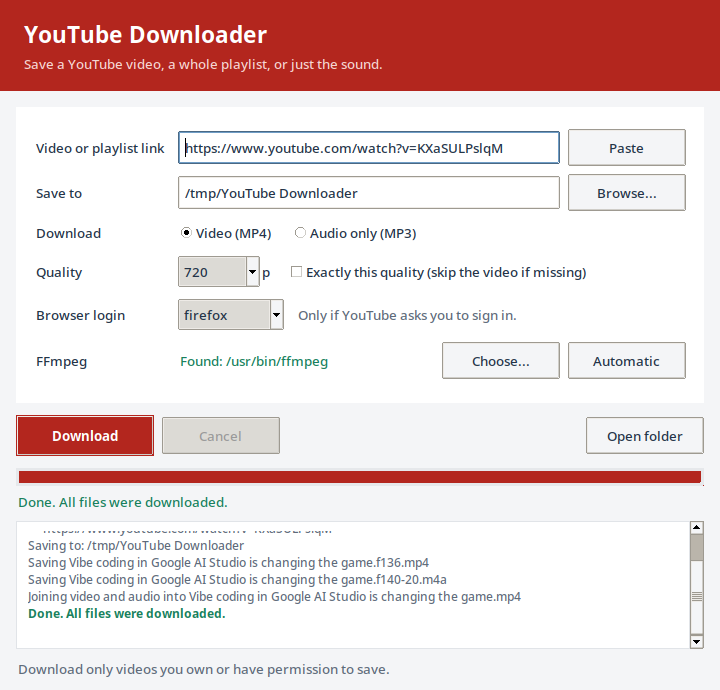

# YouTube Downloader — desktop app

A small window app that does everything the command-line program in
[`../code`](../code) does: one video, a whole playlist, audio only (MP3), a quality
of your choice, an optional browser login, and a custom FFmpeg. It reuses
`code/downloader.py` unchanged.

The built app needs **no Python and no setup** on the receiver's computer:
unpack it and double-click. It runs on Windows, macOS, and Linux.



## What each file does

| File | Purpose |
|---|---|
| `presentation.py` | Stable combined progress and Persian display text |
| `test_presentation.py` | Progress, RTL display, and Linux font-build regressions |
| `app.py` | The window (Tkinter) and the background download; English comments throughout |
| `build.py` | Builds the app for the current operating system with PyInstaller and packs it into one archive |
| `requirements.txt` | `yt-dlp`, `deno` (YouTube needs a JavaScript runtime), and `pyinstaller` |
| `test_app.py` | Offline helper and worker tests (no window, no internet) |
| `assets/` | The app icon: `icon.png` (window, Linux), `icon.ico` (Windows), `icon.icns` (macOS) |
| `ffmpeg/` | *Optional, you create it:* put an FFmpeg program here to bundle it into the app |

## Run from source (for developers)

Use Python 3.10+ **with Tk**: python.org on Windows and macOS; on Linux the system
Python plus `sudo apt install python3-venv python3-tk`. (Conda's Tk has no smooth
fonts, so do not build with Conda.)

```bash
cd desktop-app
python3 -m venv .venv
source .venv/bin/activate          # Windows PowerShell: .venv\Scripts\Activate.ps1
python -m pip install --upgrade pip
python -m pip install -r requirements.txt
python app.py                      # opens the window
python -m unittest -v              # 27 tests, ends with OK
```

## Build the app

For complete Persian instructions, see [BUILD.md](BUILD.md). Update dependencies
first with `python -m pip install -U -r requirements.txt`, then check the source
with `python app.py --check`. After code edits, rerun the build below. Replacing
pip packages does not update an already built executable.

```bash
python build.py
```

The builder validates the engine version, matching local EJS scripts, and Deno
2.3+. It explicitly collects EJS modules, JavaScript files, and dependency metadata
into the app. The startup log shows both yt-dlp and EJS versions. Installing plain
`yt-dlp` without `[default]` omits the solver scripts and can cause `n challenge
solving failed` or `The page needs to be reloaded`; refreshing YouTube does not
repair those missing dependencies. Keep the tested nightly minimum in requirements
for the newer YouTube default clients.

| Built on | Result in `dist/` | Give this file to others |
|---|---|---|
| Windows | `YouTube Downloader\YouTube Downloader.exe` | `YouTube-Downloader-windows-amd64.zip` |
| macOS | `YouTube Downloader.app` | `YouTube-Downloader-macos-arm64.zip` (or `-x86_64`) |
| Linux | `YouTube Downloader/YouTube Downloader` | `YouTube-Downloader-linux-x86_64.tar.gz` |

A `.sha256` file with the archive's fingerprint is written next to it.
PyInstaller builds only for the system it runs on: build the Windows app on
Windows, the macOS app on a Mac.

Measured on Linux: build time 24 s, archive 65 MB (the app folder is 144 MB, of
which 96 MB is `deno`), window open in 0.6 s, about 64 MB of RAM while idle.

### Optional: bundle FFmpeg

Without FFmpeg the app still works, but videos are limited to the ready-made files
(usually up to 360p) and audio stays M4A. To ship FFmpeg inside the app, download
a build for that system from <https://ffmpeg.org/download.html>, put the program at
`desktop-app/ffmpeg/ffmpeg` (`ffmpeg.exe` on Windows), and run `build.py` again.
FFmpeg has its own licence (LGPL/GPL): include its licence text when you share it.

## Install on a new computer (no Python needed)

- **Windows:** unzip, open the folder, double-click `YouTube Downloader.exe`. If
  SmartScreen says "Windows protected your PC", click **More info → Run anyway**
  (the app is not code-signed). For a shortcut: right-click the `.exe` → **Send to →
  Desktop**.
- **macOS:** unzip, drag `YouTube Downloader.app` to **Applications**. The first
  time, right-click it → **Open** → **Open** (or System Settings → Privacy &
  Security → **Open Anyway**).
- **Linux:** `tar -xzf YouTube-Downloader-linux-x86_64.tar.gz`, then run
  `"./YouTube Downloader/YouTube Downloader"` or double-click it.

Check the archive before opening it: `certutil -hashfile FILE SHA256` (Windows),
`shasum -a 256 FILE` (macOS), `sha256sum FILE` (Linux) — the result must match the
`.sha256` file.

**Uninstall:** delete the app folder (or the `.app`) and the small settings file
`.youtube-downloader.json` in your home folder.

## Progress and Persian text

Progress is combined across video/audio streams and remains nondecreasing for
each video, even when HLS revises its byte estimates or retries a fragment. The
bar uses fragment counts when available, reserves the last 2% for postprocessing,
and reaches 100% only on success. A playlist starts a new bar for each item.

The log uses a readable proportional font with Persian glyphs. Display-only
letter shaping and bidirectional ordering fix mixed Persian/English titles in
Tk 8; filenames and download metadata retain their original Unicode text.
Linux builds require Tk with Xft. Follow [BUILD.md](BUILD.md) to create the build
environment with `/usr/bin/python3`; some Conda builds only have bitmap fonts.

## Security and resources

- No installer, no administrator rights, no background service, no auto-update,
  no data sent anywhere except the requests to YouTube itself.
- Browser cookies are read only when you choose a browser, only on your computer,
  and are never saved.
- The settings file stores only your last choices (folder, quality, mode, browser,
  FFmpeg path).
- The app checks FFmpeg once before downloading and stops with a clear message if
  it cannot run.

The step-by-step guide is **Chapter 9** of the tutorial books in [`../docs`](../docs).

Download only videos that you own or have permission to save.

Author: [Alireza Khajehvandi](https://alirezaaies.github.io/)
